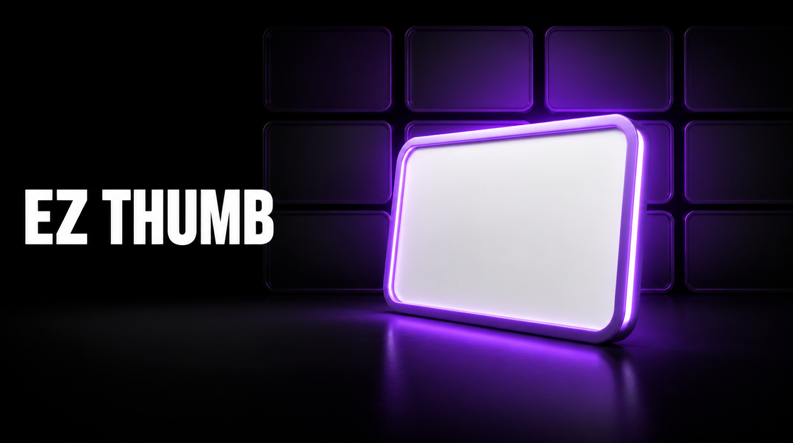

<p align="center">
  
</p>

# EZ Thumb

> **YouTube thumbnail and title packaging** for [Claude Code](https://claude.ai/code). Onboard once against your real competitors. Package every video after that against evidence from your actual niche, instead of the same twelve thumbnail rules everyone else already has.

<p>
  <a href="https://www.charlieautomates.com/"></a>
  <a href="https://www.npmjs.com/package/ez-thumb"></a>
  <a href="https://www.npmjs.com/package/ez-thumb"></a>
  <a href="https://www.npmjs.com/package/ez-thumb"></a>
  <a href="LICENSE"></a>
  <a href="https://github.com/charlesdove977/ez-thumb/stargazers"></a>
</p>

**Want thumbnails like this on autopilot?** Join [CC Strategic AI +](https://www.skool.com/cc-strategic-ai-plus/about): my 27-day Claude Code mastery program with a 1-click install setup file, and you work with us to land your first AI client in 90 days, or your money back.

Step-by-step guide and setup walkthrough: [EZ Thumb guide on charlieautomates.com](https://charlieautomates.com/free-resources/#ez-thumb)

---

## Install

```bash
npx ez-thumb install --with-commands
```

Restart Claude Code, then:

```
/ez-thumb-onboard     once
/ez-thumb             every video after that
```

That is the whole setup.

---

## The problem

Every thumbnail guide gives you the same rules. Rule of thirds. Bright colors. Big face. Keep the text short.

Those rules were measured on somebody else's audience, in somebody else's niche, at some point in the past. They are not wrong exactly. They are just not about you.

Here is how fast it moves. In one real 15-day window in a single niche, a framing running at **19.55x** median breakout fell to **1.79x**. Nothing changed except that everyone copied it and the audience stopped seeing it. Any static rule you were handed is a photograph of a moving thing.

And it gets worse, because most thumbnail research is built on numbers that were never real. Bought views are common in AI, business, finance and crypto niches. One channel in a corpus this skill was built against averaged **111,777 views on 56 likes**. That is a 0.05 percent like rate while its neighbours ran 2 to 4 percent. Its thumbnails looked incredible. They proved nothing, because the clicks did not happen the way they appeared to.

Copy that thumbnail and you have copied an advertisement.

## What EZ Thumb does instead

It builds you a corpus of your own, once, and then designs against it.

```
/ez-thumb-onboard   ONE TIME
  1  profiles your channel, assets, and what has already worked
  2  finds your competitors      vidIQ MCP, or you name them
  3  pulls their best thumbnails Apify MCP, last 90 days, top 5 each
  4  DOWNLOADS every image       saved to reference/<date>-<niche>/
  5  reads every single one      vision, one CSV row per thumbnail
  6  flags the bought views      like rate under 0.5 percent
  7  writes all of it back into itself

/ez-thumb           EVERY VIDEO AFTER
  reads what it already learned, packages your video against it
```

### The competitor pull is what makes the output yours

This is the part worth understanding before you install it.

Step 4 is not a cache. **The thumbnails are downloaded and kept**, filed by channel and sorted by performance:

```
skill/reference/2026-08-31-your-niche/
  README.md          the findings, with a generated: date stamp
  records.csv        one row per thumbnail, 15 columns
  thumbnails/
    competitor-a/000212554-2026-07-10-how-i-built-a.jpg
    competitor-a/000103342-2026-07-09-gpt-made-this.jpg
    competitor-b/000285219-2026-07-23-turn-this-into.jpg
    ...
```

The nine digit prefix is the zero-padded view count, so every channel folder sorts worst-to-best on sight.

Those saved images are then **used as the working reference every time you run `/ez-thumb`**. Not as background flavour, as a hard requirement:

- Before writing anything, it reads the corpus and names the **current cliche in your niche**, so your concepts either avoid it or break it on purpose
- It ranks your niche's **concept carriers** by breakout, so it knows whether faces, screens, comparisons or objects actually win where you compete
- **Every concept it gives you cites a real thumbnail by filename.** A concept with no citation is a guess, and this skill will not ship one
- It opens the top outliers and describes what they do that the median frame does not
- Anything flagged as bought traffic is labelled *composition reference only* out loud whenever it is cited

So the thumbnails you get out are shaped by the actual visual language of your competitors, in your niche, from the last 90 days. Not by the average of everyone's YouTube advice.

Run `/ez-thumb refresh` when the set changes or the corpus goes stale, and it keeps the old folder so you can see which patterns rose and which burned out.

## The part that makes it different

**It writes what it learns back into itself.**

Most skills are a form you fill in every session. This one is a tool that remembers. After onboarding, the installed skill directory holds your channel profile, your chosen data source, your competitor corpus, and a dated findings section appended to its own frameworks.

Two consequences worth knowing:

- **The whole configured skill is one folder.** Copy it to another machine and it is still onboarded. There is no hidden state file to lose.
- **`npx ez-thumb update` preserves it.** A version bump never costs you your onboarding.

And when new evidence contradicts something already written in a framework, it **conditions** the old rule rather than deleting it. The old finding keeps its date and its scope; the new one sits beside it. Six months later you can still tell whether the guidance changed because of measurement or because somebody had an opinion.

---

## Two rules it enforces that most research skips

**Rank on breakout, never raw views.**

```
Channel A   30,000 subs   20,000 views   ->  0.67x   the thumbnail worked
Channel B  900,000 subs  200,000 views   ->  0.22x   the thumbnail underperformed
```

Sorted by raw views, B looks like the winner and you copy the wrong thumbnail. Almost every thumbnail teardown on the internet makes this exact mistake.

**Flag bought views before learning anything from them.**

Like rate under 0.5 percent, in a set where peers run 2 to 4 percent, gets marked as paid inventory. Excluded from every aggregate. Still usable as a composition reference, never as proof that a thumbnail earned a click.

---

## What you get from a run

Three genuinely different concepts, not three phrasings of one. Each carries a title, the concept object, one named curiosity lever, an ascii composition sketch with the bottom right kept clear for YouTube's timestamp, and the corpus evidence backing it or the niche cliche it deliberately breaks.

Pick one, and it writes five image prompts as five different visual bets: angle, moment, contrast, distance, emotional beat.

Then it scores everything on the Four Cs and **takes the lowest, not the average.** A frame that is 10 on composition and 4 on curiosity is a 4, because nobody clicks it. The pass bar is 8, and anything under it comes back with one specific fix, never "make it pop."

---

## Requirements

| | | |
| --- | --- | --- |
| **Required** | Apify MCP | Pulls competitor videos, stats and thumbnails. A free token gets you started |
| Optional | vidIQ MCP | Auto-discovers your competitors. Without it you name them yourself, which is often the better list |
| Optional | Any image generation MCP | Generates the variations |

**Without an image generator you still get everything that matters:** the concepts, the compositions, the corpus evidence, the scoring, and five copy-paste prompts for whatever generator you already use. Generation is the last mile, not the product.

Check what you have:

```bash
npx ez-thumb doctor
npx ez-thumb status      # install state, onboarding state, corpus age
```

---

## Commands

| Command | What |
| --- | --- |
| `/ez-thumb-onboard` | One time. Profile, competitors, corpus, self-write |
| `/ez-thumb` | Package a video into titles plus thumbnail concepts |
| `/ez-thumb score` | Score an existing thumbnail against the Four Cs |
| `/ez-thumb refresh` | Rebuild the corpus, keep the profile, report what changed |

```bash
npx ez-thumb install --with-commands   # install, plus slash command stubs
npx ez-thumb update                    # upgrade, keeping your onboarding
npx ez-thumb update --clean            # upgrade and start fresh
npx ez-thumb uninstall --force         # remove an onboarded install
npx ez-thumb install --project         # into ./.claude/ instead of ~/.claude/
```

---

## A note on the corpus and other people's work

The thumbnails EZ Thumb pulls belong to the creators who made them. They are downloaded to your machine for your own analysis, the same way you would open a competitor's channel and look at it.

The package **gitignores the corpus by default**, and ships with none. Do not commit competitor thumbnails to a public repository, and do not redistribute a corpus. If you fork this, leave that gitignore rule alone.

The skill also writes its flags as data properties rather than as accusations about people. "0.05 percent like rate, composition reference only" is a measurement. Anything stronger than that is a claim you do not need to make.

---

## Where the knowledge came from

EZ Thumb is not opinion. Every framework in it traces to a named source, and where the sources disagree it says so instead of quietly picking a side.

### The forensic teardown

Five of the highest-performing public thumbnail teachings on YouTube were run through a full forensic pass: downloaded, sampled at one frame per second, transcribed locally with Whisper, and read frame by frame with vision. All five transcripts end to end. **108 contact sheets. Nothing skimmed, nothing sampled.**

| Creator | Video | Views |
| --- | --- | --- |
| Isaac | [How I Actually Make Viral Thumbnails](https://www.youtube.com/watch?v=mI7cq4uHCZ4) | 1,017,482 |
| Website Learners | [FREE AI Makes YouTube Thumbnails Like MrBeast](https://www.youtube.com/watch?v=0FDiB-nrQ8M) | 727,384 |
| DecodingYT | [How to Make VIRAL YouTube Thumbnails](https://www.youtube.com/watch?v=9GGr9WuKIMQ) | 576,102 |
| TubeBuddy | [11 Thumbnail Design Hacks Top Creators Use](https://www.youtube.com/watch?v=dB6DXcZo6hE) | 351,116 |
| Devesh Sharma | [The Ultimate Guide to Creating Viral Thumbnails](https://www.youtube.com/watch?v=Flx1Ugy3ZPQ) | 235,281 |

That pass produced `frameworks/creator-consensus.md`: **fifteen rules that survived the cross-check**, a merged twelve-format library, and **seven places where these creators flatly contradict each other**, each with the resolution this skill actually encodes. A few of those contradictions:

- **Research your niche, or refuse to.** One says copy what is working. Another calls that the worst thing you can do, because it makes you the eleventh instance of a frame the audience already saw at 100K. Resolved as: research in-niche to find the cliche, take visual inspiration out-of-niche. Research is for diagnosis, not imitation.
- **Colour theory, or a fixed palette.** The wheel maximizes contrast inside one frame. A locked five-slot palette maximizes recognition across a channel page. They solve different problems, so use both.
- **Consistency, or formula fatigue.** Consistency wins for about five videos, then starts costing clicks. Hold the font and palette skeleton, rotate the accent and the format.

The single-source rules are kept too, because a rule only one person teaches is often the most valuable one: the dark-mode contrast trap, before-goes-left-after-goes-right, the 45 percent of viewing that happens on a TV, the recognizable-interface workaround for creators with no famous face, and *more elements equals less focus, fewer words equals larger text*.

### The MasterClass breakdown

The **Thumbnail MasterClass** by **david, dill and ant** is where the backbone comes from. **Go buy it, it is worth it.** What EZ Thumb encodes from it:

| From the deck | Lives in |
| --- | --- |
| The Four Cs: Composition, Colour, Clean Assets, Curiosity | `frameworks/four-cs.md` |
| The four curiosity levers, and good clickbait as exaggerating interest not reality | `frameworks/curiosity-gap.md` |
| The five step process: Needs, Sketch, Prompt, Mockup, Design | `frameworks/five-step-process.md` |
| Packaging concepts before design, and the Safe / Emotion / Contrast / Leverage spread | `frameworks/five-step-process.md` |
| Audience calibration by age, and the credibility-versus-energy split | `frameworks/audience-calibration.md` |
| Watch time above CTR, and testing three distinct ideas as paired title-plus-thumbnail units | `frameworks/testing-and-metrics.md` |
| **The bottom right belongs to YouTube's duration stamp** (no other source in the corpus mentions it) | `frameworks/four-cs.md` |
| Free composition grid guide at [thumbnailmockup.com](https://thumbnailmockup.com) | `frameworks/four-cs.md` |

No slides, no deck text and no course material are redistributed here. These are the ideas, restated, credited, and cross-checked against five independent sources.

### Measured in production

The breakout ranking, the bought-view filter, the pattern-decay numbers, and the two generator failure modes (craft language getting typeset into the frame, fabricated numbers in generated UI) all came out of real runs, not from any guide.

---

## License

MIT. Do what you want with it.

Built by [Charles J Dove](https://www.charlieautomates.com/) at Charlie Automates.
More free Claude Code skills and plugins: **[charlieautomates.com/free-resources](https://www.charlieautomates.com/free-resources)**
